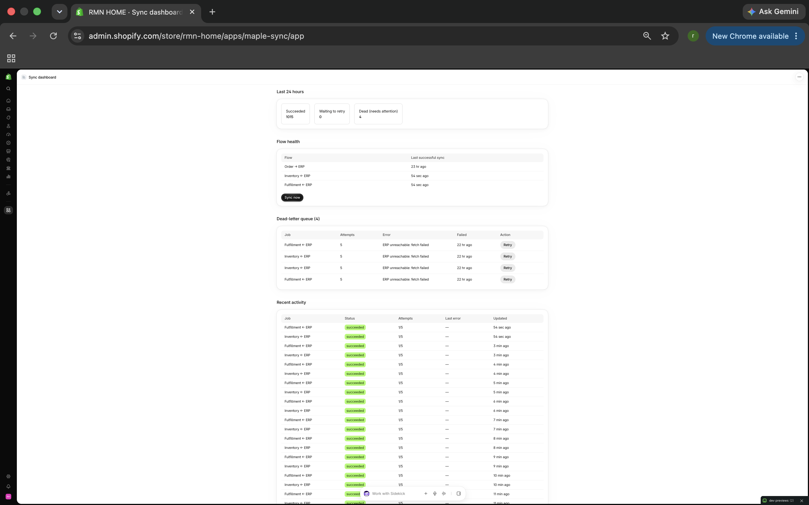
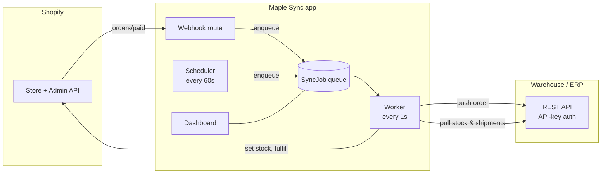
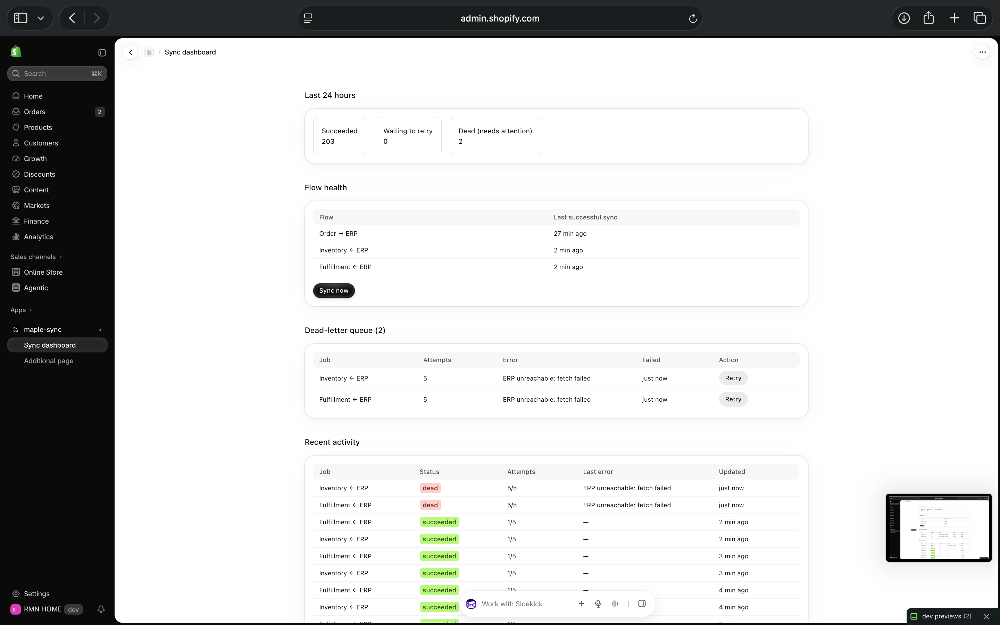
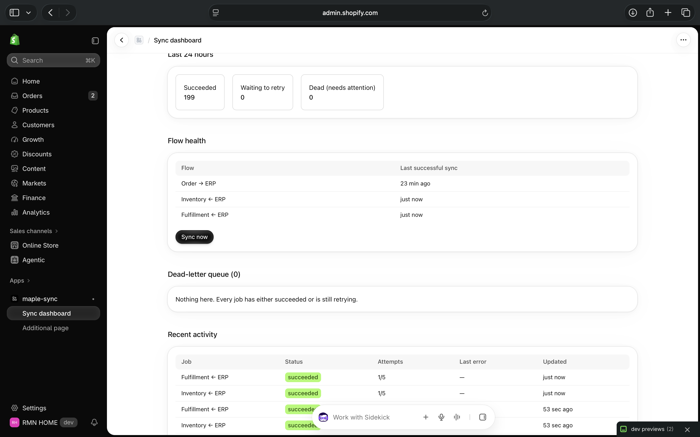
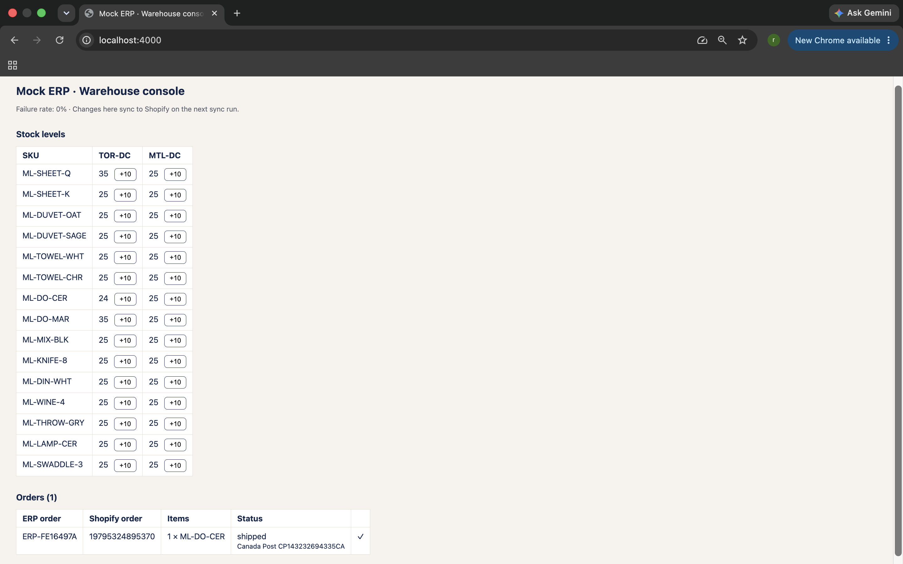

# Maple Sync: Shopify ↔ ERP Integration


Middleware that keeps a Shopify store in sync with a warehouse/ERP system: **inventory**, **orders** and **fulfillments**, with a job queue that retries failures and never loses an order when the back end is down.

Built for a fictional Canadian home-goods brand, **Maple & Linen Home**, with two distribution centres (Toronto and Montreal).

**Tech:** TypeScript · Node.js · React Router · Shopify Admin GraphQL API · Webhooks · Prisma · Express · Vitest · GitHub Actions



---

## What it does

| Flow | Direction | Trigger | Result |
|---|---|---|---|
| **Inventory** | ERP → Shopify | Every minute | Stock per warehouse is set on the matching Shopify location (Toronto DC → Shop location, Montreal DC → My Custom Location) |
| **Orders** | Shopify → ERP | `orders/paid` webhook | Paid orders are sent to the ERP, which reserves stock for picking |
| **Fulfillment** | ERP → Shopify | Every minute | Orders shipped in the ERP are marked fulfilled in Shopify with the carrier and tracking number |

A **sync dashboard** inside the Shopify admin shows job counts, the health of each flow, a dead-letter queue with a **Retry** button, and live recent activity.

## Architecture



The webhook only **queues** work and answers Shopify instantly. Slow or unreliable calls to the ERP happen in the background worker.

## Reliability design

- **Database-backed job queue.** Every task is saved as a `SyncJob` row before it runs, so nothing is lost if the ERP or the app restarts.
- **Exponential backoff with jitter.** Failed jobs retry after 2s, 4s, 8s, 16s (capped at 5 minutes), with up to 20% randomness so retries don't all fire at once. The ERP's `Retry-After` header is respected for rate limits.
- **Retryable vs permanent errors.** Network failures, 429 and 5xx responses are retried. A 400 or 401 goes straight to the dead-letter queue, because retrying won't help.
- **Dead-letter queue.** After 5 attempts a job is parked as `dead` and shown on the dashboard, where it can be replayed once the problem is fixed.
- **Idempotency at every layer.**
  - Each job has a unique `dedupeKey`, so a duplicate webhook can't create a second job.
  - The ERP returns the existing order if the same Shopify order is sent twice.
  - Shopify inventory writes use the `@idempotent` directive.
  - Fulfillment checks for open fulfillment orders first, so a retry can never ship twice.
- **Incremental sync with cursors.** The app asks the ERP only for what changed since the last successful sync, and moves the cursor forward only after every update succeeds.
- **Crash recovery.** Jobs stuck in `running` after a restart are put back in the queue.

## Outage test

With the ERP stopped, jobs retried with backoff and moved to the dead-letter queue. Nothing was lost:



After bringing the ERP back and clicking **Retry**, every job succeeded:



## Mock ERP

`mock-erp/server.ts` is a small Express service that stands in for an ERP or WMS like NetSuite or SAP:

- REST endpoints for inventory and orders, protected by an API key
- A **chaos mode** (`ERP_FAILURE_RATE=0.3`) that randomly returns 503s and 429s with a 100–500 ms delay, to test retry handling
- A warehouse console at `localhost:4000` to receive stock and ship orders by hand



## Debugging notes

1. **Shopify API version change.** After upgrading, every inventory write failed with *"The @idempotent directive is required for this mutation."* The 2026-04 Admin API made idempotency keys mandatory for inventory mutations, and added a required `changeFromQuantity` field. The queue retried with backoff, then parked the jobs in the dead-letter queue. After the fix, replaying them from the dashboard brought everything back in sync.
2. **Worker kept running old code.** In development, saving a file reloads the code, but the worker's timers kept running the previous version. *Fix:* the worker stores its timers globally and clears them on each start, so only one worker runs and it always uses the latest code.
3. **Order webhooks need protected customer data access.** Shopify blocks order webhooks until the app declares why it needs order data. The app only reads SKUs and quantities, so no personal fields were requested.
4. **SKUs that exist on only one side.** Products missing from the ERP's catalogue show 0 stock in Shopify. The sync logs and skips unknown SKUs instead of failing the whole batch.

## Tests and CI

```bash
npm test
```

- `tests/queue.test.ts`: backoff timing, the 5-minute cap and jitter
- `tests/erp.test.ts`: success, 503, 429 with `Retry-After`, 400, and network failures are each classified correctly

GitHub Actions runs the tests on every push and pull request (`.github/workflows/ci.yml`).

## Project structure

```
app/
  erp.server.ts                    ERP client: timeouts, error classification
  queue.server.ts                  Job queue: enqueue, backoff, dead-letter, retry
  worker.server.ts                 Background worker and scheduler
  inventory.server.ts              ERP stock → Shopify locations
  orders.server.ts                 Paid orders → ERP
  fulfillments.server.ts           ERP shipments → Shopify fulfillments
  routes/app._index.tsx            Sync dashboard
  routes/webhooks.app.orders_paid.tsx
mock-erp/server.ts                 Mock ERP / warehouse system
prisma/schema.prisma               SyncJob and SyncCursor models
tests/                             Vitest tests
```

## Running locally

Requirements: Node.js 20+, a free [Shopify Partner account](https://partners.shopify.com) and a development store.

```bash
git clone https://github.com/rkd453003-wq/maple-sync.git
cd maple-sync
npm install
npx prisma migrate dev
```

Run in two terminals:

```bash
npm run erp          # mock ERP on http://localhost:4000
shopify app dev      # the Shopify app; press p to open it
```

Products in the store need SKUs matching the ERP (e.g. `ML-SHEET-Q`). Order webhooks also need protected customer data access (Partner Dashboard → your app → API access requests).

## Roadmap

- Price sync from the ERP, with market-aware pricing
- Partial fulfillments and split shipments
- Alerts (email or Slack) when a job lands in the dead-letter queue
- Postgres and a hosted deployment instead of SQLite

---

Built by **Ramen K** on Shopify's [React Router app template](https://github.com/Shopify/shopify-app-template-react-router).